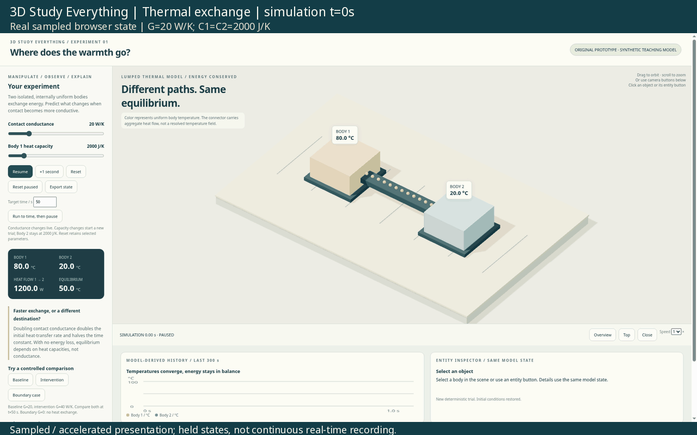
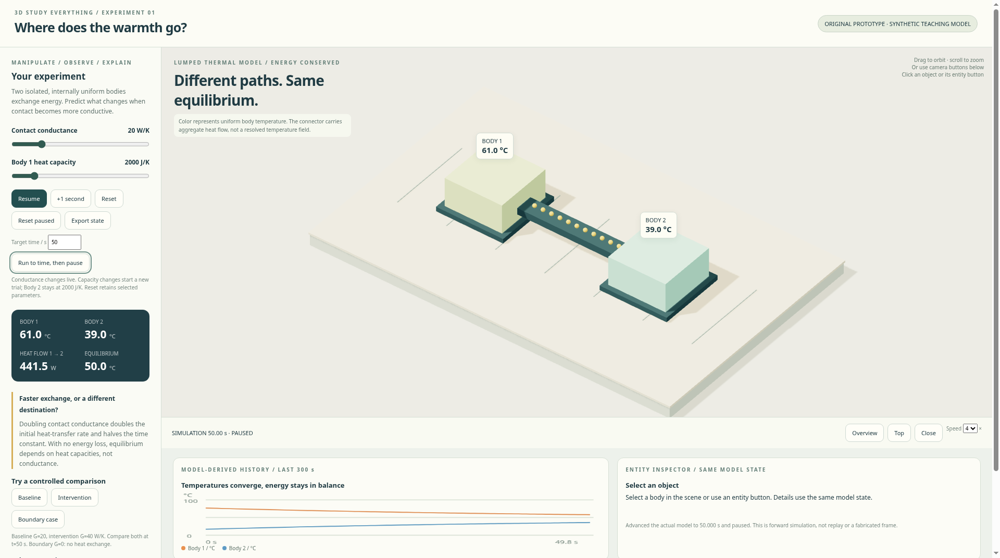
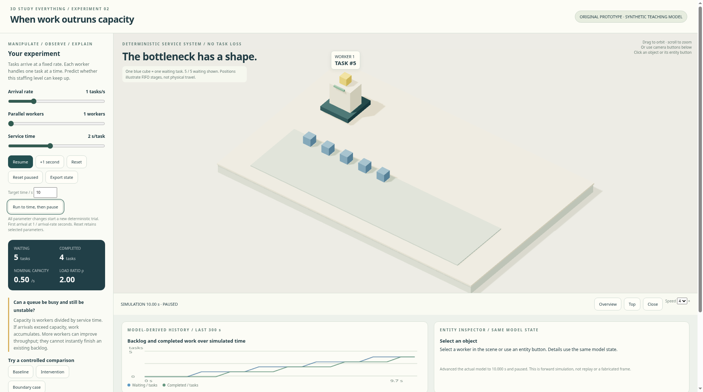
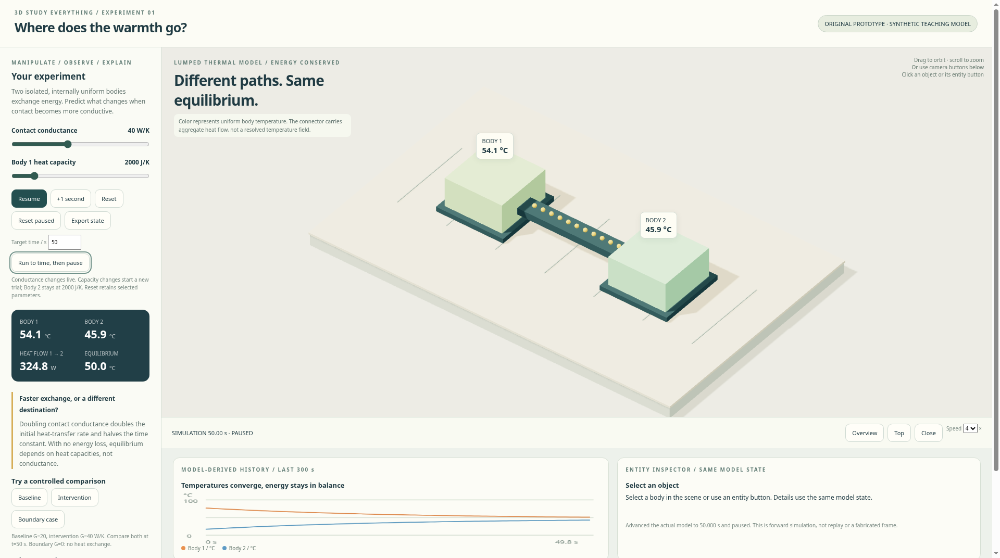
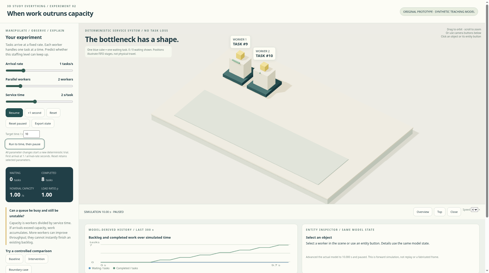

# 3D Study Everything

**Give an AI a subject. Build a world you can test.**

A portable, English-first skill for turning business knowledge and domain into interactive 3D learning experiments. It combines causal modeling, original visual design, direct manipulation, layered verification, and scene-appropriate time control. The name stays **3D Study Everything**. "4D" here means 3D plus time when the lesson needs it, not a fourth spatial dimension.

**Status: public source with original visual evidence.** Source, four still screenshots, and a sampled-state GIF are published at [xiqing21/3d-study-everything](https://github.com/xiqing21/3d-study-everything). Two original runnable examples have 10 passing numerical tests plus selected desktop-browser comparisons and interactions checked by a coordinating operator. Broader device/accessibility/performance checks and independent model-to-model generation trials remain untested. No universal-model or consistent-quality guarantee is made. The Skill now recommends time-control levels by scene; the included demos still provide only the verified L1 controls (pause, reset, speed, step, and forward run-to-time), not history seek or checkpoint branching.

## Install the Skill

```sh
npx skills add xiqing21/3d-study-everything --skill 3d-study-everything
```

For hosts supported by the third-party [Skills CLI](https://github.com/vercel-labs/skills); requires Node.js/npm and internet. The exact command was tested with CLI **1.9.0** in a fresh isolated project: root `SKILL.md` discovered, Skill and relative helpers installed, all installed file hashes matched the reviewed snapshot. An explicit Claude Code **file-install** target was also tested; no model execution or universal host support is implied. This installs the Skill, not a hosted demo. [Details, a pinned command and alternatives](INSTALL.md).

- **File-based Skill host:** install this folder using the host's documented Skill directory/discovery process. Keep `SKILL.md`, `references/`, `templates/` and `evaluation/` at the same relative locations. Do not assume one universal installation path.
- **One global instruction/Skill body:** use [the self-contained body](installation/skill-body-self-contained.md), which needs no helper files or persistent local paths. Name and description are in [metadata.json](installation/metadata.json). Saving files here is not the same as installing the Skill in a host.
- **Project/chat attachments:** attach `SKILL.md` and referenced helpers, or paste the self-contained body if the host cannot resolve relative files. Code execution and browser tools are required to verify generated applications.
- **Advanced/full body:** [complete body without YAML](installation/skill-body-full.md), plus [helper installation plan](installation/HELPERS.md).

See [INSTALL.md](INSTALL.md) for capability limits and post-install verification.

## Start
1. Read [SKILL.md](SKILL.md), or use the installation choice above.
2. Supply a subject and desired audience. Optional: reference material, constraints, platform, or learning goal.
3. Ask the assistant to deliver a model contract, an interactive artifact, a tested experiment, limitations, and evidence.

Example prompt:
> Use 3d-study-everything. Teach a new operations analyst why adding workers sometimes fails to clear a service backlog. Build a real 3D scene with a visible queue, measurable arrivals/completions, pause/reset, and a matched baseline/intervention. State simplifications. Suggest one isolation mode and two useful extensions. Verify it; mark any unavailable browser tests pending.

## Try the original examples
No install or network access is needed to run the included static examples. A pinned, MIT-licensed Three.js renderer is vendored locally.

```sh
python3 -m http.server 4186 --bind 127.0.0.1 --directory .
# http://localhost:4186/examples/thermal.html
# http://localhost:4186/examples/queue.html
node --test evaluation/models.test.mjs
```

Node.js is required only for model tests. Use HTTP, not a double-clicked file URL. The examples use browser ES modules and WebGL2. The queue renders at most 80 waiting tasks while preserving the entire count, explicitly disclosed on screen.

- **Thermal exchange:** two lumped bodies, adjustable conductance and heat capacities, analytical update, energy conservation, temperature traces. Not a spatial temperature-field solver.
- **Service bottleneck:** deterministic arrivals and identical parallel servers, service-time and staffing interventions, stable task IDs, conserved work, explicit backlog. Not an M/M/c model and not a real staffing recommendation.
- **Third-domain trial:** a biology/SIR generation brief is included in the evaluation plan, not an implemented or validated medical forecast.

## Watch two real sampled experiments



A **10-second sampled-state presentation**, not a continuous real-time recording: six thermal states at t=0/10/20/30/40/50 s, then six queue states at t=0/2/4/6/8/10 s. Every state was reached with the real model and paused before capture; no intermediate model states were generated. Original captures were 1920×1072; the captioned GIF is 1280×800. A coordinating operator reviewed playback and confirmed both scenes change, with no black frame; caption type is slightly small but the animation is usable. This is not history-seek functionality. [Encoding and provenance](docs/ANIMATION-PROVENANCE.json).

## Real desktop comparisons
Actual viewport: **1920×1072**, not an earlier requested size. These unmodified browser captures are original new examples, not generated illustrations. Clicking/picking and camera interactions were tested separately; the screenshots themselves show unselected inspectors.

| Thermal exchange, same t=50 s | Service queue, same t=10 s |
|---|---|
| **Baseline:** G=20 W/K, 61.0 / 39.0 °C | **Baseline:** 1 worker, 4 completed, 5 waiting, 1 busy |
|  |  |
| **Intervention:** G=40 W/K, 54.1 / 45.9 °C; same 50 °C equilibrium | **Intervention:** 2 workers, 8 completed, 0 waiting, 2 busy |
|  |  |

For exact-time reproduction: preset → **Reset paused** → enter 50 (thermal) or 10 (queue) → **Run to time, then pause**. The real model advances; no frame is fabricated. These examples do **not** include history seek or checkpoint branches; do not describe them as L2/L3 or as a complete spacetime ("4D") simulator. See [time-design guidance](references/time-design.md), [validation report](docs/VALIDATION.md), [image provenance/checksums](docs/SCREENSHOTS.json), and [three-model matrix](evaluation/MODEL-MATRIX.md). All three independent-model slots are **unknown / not run**. Browser-rendered scenes do not independently establish GPU hardware acceleration or a performance certification.

Traffic was the reference workflow; its source and screenshots are not included in this MIT package because its reuse license has not been established.

## Contents
- `references/`: mechanism design, time-control levels, visual/interaction guidance, a tested sandbox visual baseline (palette, lighting, camera presets, geometry budget, offline single-file packaging), traffic case-study lessons, licensing/release gates.
- `templates/`: learning contract, delivery report, portable prompt, and the guided experiment deck pattern (predict → reveal → apply → reset).
- `evaluation/`: rubric, cross-domain/cross-model protocol, numerical model tests, honest results matrix.
- `installation/`: full and self-contained body files, metadata and helper-install guidance.
- `docs/`: four real stills, a sampled-state GIF, and scoped validation/provenance records.
- `examples/`: original thermal and service-queue prototypes sharing a small renderer shell.
- `vendor/three/`: pinned upstream renderer plus its license. No original traffic application source is bundled.

## 中文快速入门
把 `SKILL.md` 和相关参考文件交给支持文件的模型，再说：

> 请按这个 Skill，把「你的业务知识或场景」做成真正可操作的 3D 学习实验。名称仍用 3D Study Everything；若有人说 4D，按「3D+时间」理解，不是四个空间维。先明确学习目标、机制、参数和可观测指标，再按场景决定时间控制做到哪一层：静态结构不必加时间轴；动态过程再推荐播放/暂停、历史查看或同checkpoint分支，不要默认全做。提供对象详情和因果解释；主动建议简化模式与延伸场景。区分真实机制、简化模型和视觉示意，不能把未做的浏览器验收、历史回放或跨模型测试写成通过。

没有代码执行或浏览器能力的模型可以输出设计和代码，但不能声称已运行、已截图或已验收。

## License and scope
Newly authored package material is MIT-licensed, except the separately licensed vendored dependency. See [LICENSE](LICENSE), [THIRD_PARTY_NOTICES.md](THIRD_PARTY_NOTICES.md), and [references/release-checklist.md](references/release-checklist.md). The private traffic reference project and its images are **not** relicensed or included. The four still captures and the sampled-state GIF depict only the original examples and are covered by this package's MIT grant; the exact upstream Three.js notice remains preserved.

## Publication scope
Reviewed Skill source, examples, tests, and the vendored Three.js runtime are in this repository. Original stills and the sampled-state GIF were uploaded as binary assets and anonymously verified against local SHA-256 digests with `image/png` or `image/gif` content types. An optional review MP4 is not part of this repository. See [PUBLICATION.md](PUBLICATION.md).
